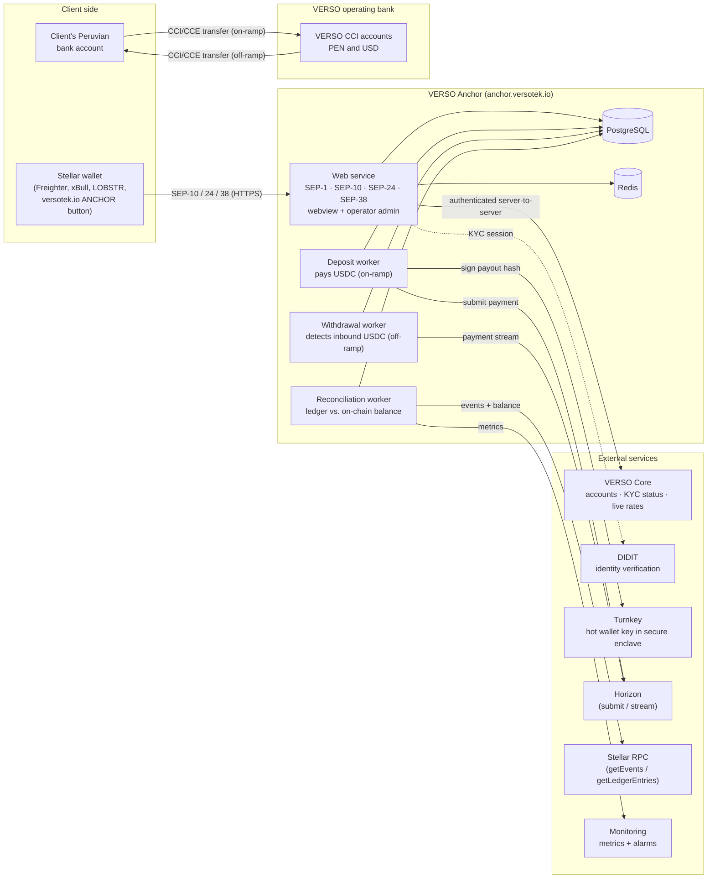
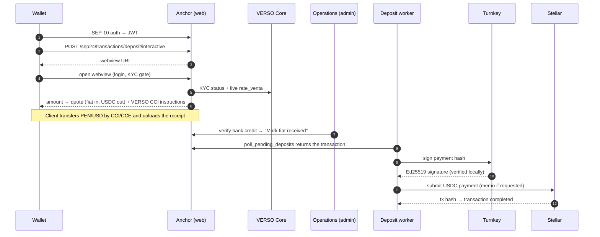
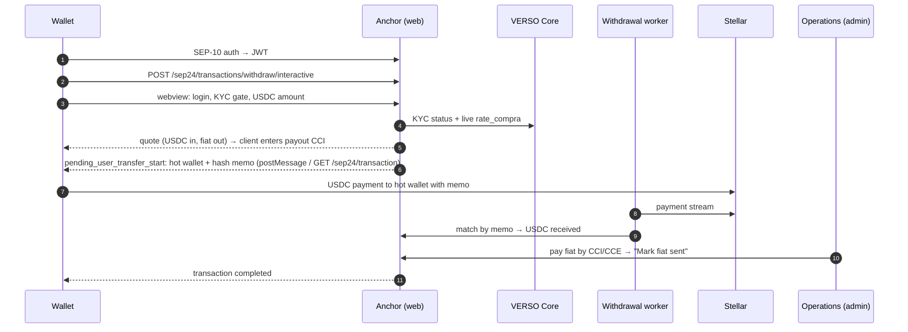

# Mainnet architecture — VERSO Stellar Anchor

How the VERSO anchor is deployed on Stellar mainnet: components, trust boundaries, keys and data flows.
Back to the [README](../README.md) · Related: [Implementation guide](IMPLEMENTATION_GUIDE.md) ·
[Callback reference](CALLBACKS.md) · [Operator runbook](RUNBOOK.md).

## Overview

VERSO is a Peruvian PSAV that converts **PEN / USD ↔ USDC (Circle)** through bank transfers over Peru's interbank
system (**CCI/CCE**). The anchor exposes the standard Stellar interfaces so any compatible wallet can use it:

| SEP | Purpose | Endpoint (mainnet) |
| --- | --- | --- |
| SEP-1 | Anchor discovery (`stellar.toml`) | `https://anchor.versotek.io/.well-known/stellar.toml` |
| SEP-10 | Wallet authentication (JWT) | `https://anchor.versotek.io/auth` |
| SEP-24 | Interactive on-ramp / off-ramp | `https://anchor.versotek.io/sep24/` |
| SEP-38 | Quotes (indicative and firm) | `https://anchor.versotek.io/sep38/` |

The anchor is built on **django-polaris** (SDF's Python reference implementation) inside VERSO's Django backend.
Testnet runs the same code in a separate environment (`https://verso-sdf-testnet.up.railway.app`).

## Component diagram

## Components

| Component | Role | Notes |
| --- | --- | --- |
| **Web service** | Serves SEP-1/10/24/38, the SEP-24 interactive webview (VERSO login, KYC gate, amount, bank details) and the operator admin | Only component with a public URL. Runs database migrations on deploy |
| **Deposit worker** | Polaris `process_pending_deposits --loop`: once operations confirm the fiat was received, builds the USDC payment and gets it signed by Turnkey | The only component holding signing credentials (Turnkey API credential, not a private key) |
| **Withdrawal worker** | Polaris `watch_transactions`: streams payments into the hot wallet and matches each one to its SEP-24 withdrawal by memo | Resumes from its stored cursor after a restart |
| **Reconciliation worker** | Ingests every USDC movement of the hot wallet through Stellar RPC `getEvents`, matches it to its SEP-24 transaction and compares the on-chain balance with the internal ledger every ~60 s | Publishes metrics; alarms notify operations by email |
| **PostgreSQL** | Polaris transactions, VERSO deposit/withdrawal metadata, reconciliation ledger and runs | Mainnet and testnet use separate databases |
| **Redis** | Cache and webview sessions | — |
| **VERSO Core** | VERSO's main platform: client accounts, KYC status, live exchange rates (`rate_venta` / `rate_compra`) | Called server-to-server with a shared secret; never exposed to wallets |
| **DIDIT** | Identity verification (KYC) | Launched from the webview when the client has no approved KYC |
| **Turnkey** | Holds the hot wallet's Ed25519 key in a secure enclave and signs payouts | See [Keys and custody](#keys-and-custody) |

## Keys and custody

| Key | Where it lives | Signs | Funds |
| --- | --- | --- | --- |
| **Hot wallet** [`GCYW…NJMM`](https://stellar.expert/explorer/public/account/GCYWYXFOWGOXOLUI6ZXBSMMRRK4KJUUVHBBSPMM6XAEOAX2YU5KZNJMM) | Inside Turnkey; generated there and never exported | USDC payouts (on-ramp); receives USDC (off-ramp) | Daily operating float only |
| **SEP-10 key** | Server environment | SEP-10 challenges only | **None** — the account does not need to exist on-chain |
| **Treasury wallet** | Separate VERSO account, not connected to the anchor or its servers | Treasury movements (funds the hot wallet) | Bulk of funds |

- The server authenticates to Turnkey as a **non-root service user** whose policy only allows signing with the hot
  wallet. Every signature is logged by Turnkey, and the credential can be revoked in seconds without changing the
  wallet address.
- Each payout's signature is **verified locally against the hot wallet's public key** before submission.
- Turnkey cannot parse Stellar transactions, so amount limits are enforced in VERSO's code (`MAX_PAYOUT_USDC`), by the
  low hot wallet balance and by the reconciliation alarms (an unexpected outflow opens a discrepancy).

Background on why Turnkey replaced AWS KMS (KMS does not sign Ed25519): README → *Architecture note*, point 2.

## Trust boundaries

| Boundary | Who is trusted | Control |
| --- | --- | --- |
| Wallet → anchor | Nobody by default | SEP-10 proves account ownership; the SEP-24 webview additionally requires a VERSO login and **approved KYC** before any amount can be entered |
| Anchor → VERSO Core | The anchor server only | Shared secret over HTTPS; wallets never call Core's internal API |
| Anchor → Turnkey | Service user with a single-wallet policy | Signatures verified locally; payout cap in code |
| Fiat ↔ USDC | VERSO operations | Fiat receipt and fiat payout are **confirmed by a person** in the admin (PSAV obligations); a withdrawal cannot be completed until its USDC payment is detected on-chain |
| On-chain ↔ internal ledger | Nobody | Independent reconciliation over Stellar RPC every ~60 s, with alarms |

## Data flows

### On-ramp (PEN/USD → USDC)

### Off-ramp (USDC → PEN/USD)

### Reconciliation

Every ~5 s the reconciliation worker reads USDC `transfer` / `mint` / `burn` / `clawback` events that involve the hot
wallet (Stellar RPC `getEvents` on the USDC Stellar Asset Contract) and stores each one once. Every ~60 s it reads the
trustline balance at a known ledger (`getLedgerEntries`) and compares it with
`opening balance + sum of stored movements` at that same ledger. Movements are matched to their SEP-24 transaction;
anything unexplained (unknown inbound/outbound, amount mismatch, balance delta, stalled ingest) opens a discrepancy and
raises an alarm. Details: README → *Tranche 2, Deliverable 3* and *Architecture note*, point 4.

## Environments and deployment

| | Mainnet | Testnet |
| --- | --- | --- |
| Home domain | `anchor.versotek.io` | `verso-sdf-testnet.up.railway.app` |
| Network | Public Global Stellar Network | Test SDF Network |
| USDC issuer | Circle `GA5Z…KZVN` | Circle testnet `GBBD…FLA5` |
| Database | Own PostgreSQL (no testnet data) | Own PostgreSQL |
| Deploy | **Manual**, only after the release was validated on testnet | Automatic from `main` |

Both environments run the same repository and differ only in configuration. Test shortcuts (mock KYC, automatic fiat
confirmation) are disabled in both. Every push runs the test suite on GitHub Actions against PostgreSQL + Redis.

## Libraries and network access

- **django-polaris 2.x** — SEP-1/10/24/38 endpoints, transaction model and workers. Polaris uses **Horizon** for
  payment submission, the withdrawal stream and SEP-10 account loading.
- **Stellar RPC** — used by VERSO's own reconciliation service (Horizon is on a deprecation path; see README →
  *Architecture note*, point 4).
- **stellar-sdk (Python)** — envelope building and local signature verification.
