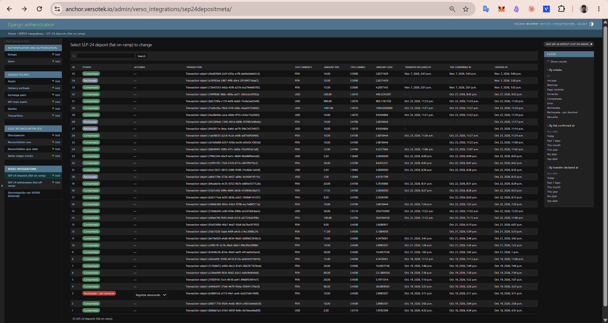
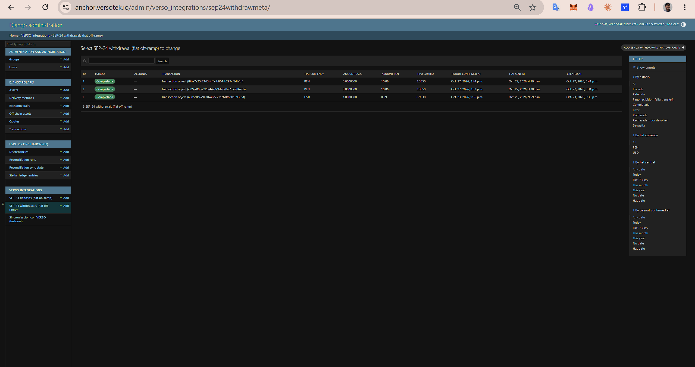
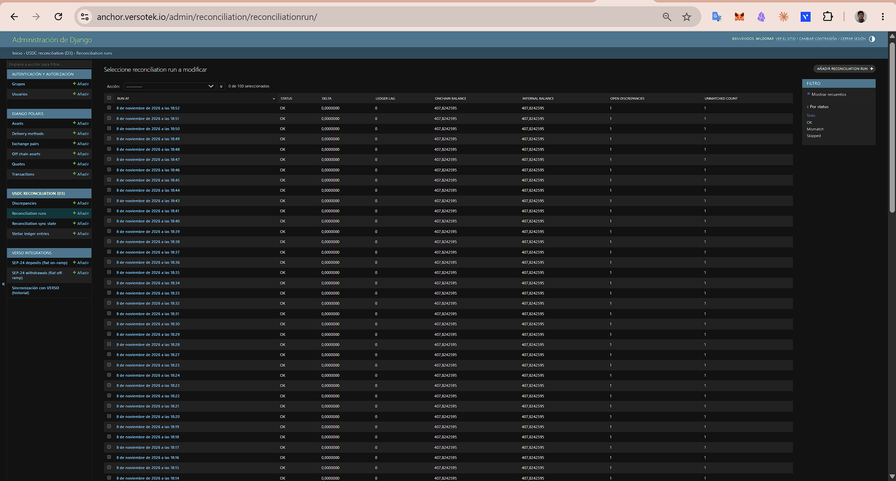

# Tranche 3 — Deliverable evidence (mainnet)

Anchor: [`anchor.versotek.io`](https://anchor.versotek.io) · Network: **Stellar mainnet** (`Public Global Stellar
Network ; September 2015`) · Live since **2026-10-16** · Hot wallet (Turnkey custody):
[`GCYWYXFOWGOXOLUI6ZXBSMMRRK4KJUUVHBBSPMM6XAEOAX2YU5KZNJMM`](https://stellar.expert/explorer/public/account/GCYWYXFOWGOXOLUI6ZXBSMMRRK4KJUUVHBBSPMM6XAEOAX2YU5KZNJMM)
· Asset: USDC (Circle) `GA5ZSEJYB37JRC5AVCIA5MOP4RHTM335X2KGX3IHOJAPP5RE34K4KZVN`

Back to the [README](../README.md) · Earlier tranches: [`T2_EVIDENCE.md`](T2_EVIDENCE.md) (Tranche 2)

**Sources.** On-chain data comes from the public Horizon API (`horizon.stellar.org`, payments of the hot wallet,
queried on 2026-11-08) and can be checked by anyone on Stellar Expert. Statuses and settlement times come from the
mainnet admin (Polaris `Transaction` and VERSO's SEP-24 metadata), cross-checked with the on-chain payment times.
Endpoint checks were run against the live anchor on 2026-11-08; the SDF anchor test suite was run on 2026-10-16.

## Summary

| #   | Deliverable                                  | Result                                                                                                                       |
| --- | -------------------------------------------- | ---------------------------------------------------------------------------------------------------------------------------- |
| 1   | Mainnet launch SEP-1/10/24/38                | **Covered** — all four SEPs live on mainnet since 2026-10-16; hot wallet with USDC trustline; SEP-1 5/5, SEP-10 14/17         |
| 2   | CCI/CCE Phase 2 semi-automated settlement    | **Covered** — 30 consecutive real operations completed (33 to date), average settlement **5.4 min**, 3 Peruvian banks, runbook published |
| 3   | Operational proof + Stellar Anchor Directory | **Covered, with a deviation** — 33 operations on Stellar Expert; Directory replaced by open access from any Stellar wallet   |
| 4   | Security hardening + audit preparation       | **Covered** — callbacks reviewed, Turnkey signing verified, edge-case suite in CI (51 tests, 340 in total), 6 issues fixed   |
| 5   | Public technical documentation               | **Covered** — implementation guide, mainnet architecture, callback reference and operator runbook on GitHub                  |

Deviations from the proposal, explained in each section: **Turnkey instead of AWS KMS** (D1, D4), **separate
treasury wallet instead of a cold-wallet dual-approval protocol** (D1), **open wallet access instead of an Anchor
Directory submission** (D3), and **fiat receipt verified manually in the bank instead of an automatic bank alert**
(D2, not a measurement criterion).

---

## Deliverable 1 — Mainnet launch: SEP-1/10/24/38

| Criterion                                                      | Evidence                                                                                                                                                                                                                                                                                                                                             |
| -------------------------------------------------------------- | ---------------------------------------------------------------------------------------------------------------------------------------------------------------------------------------------------------------------------------------------------------------------------------------------------------------------------------------------------- |
| Hot wallet active on mainnet with USDC trustline               | [`GCYW…NJMM`](https://stellar.expert/explorer/public/account/GCYWYXFOWGOXOLUI6ZXBSMMRRK4KJUUVHBBSPMM6XAEOAX2YU5KZNJMM): trustline to Circle USDC created on 2026-10-14 and **signed by Turnkey** ([`8d7e05e2…`](https://stellar.expert/explorer/public/tx/8d7e05e29ae29be7f987b7870e9fc909815a8cc0a8fe869e53b69681c9af1643)); 30 client operations and every payout since then |
| `stellar.toml` for mainnet with zero validation errors         | [`/.well-known/stellar.toml`](https://anchor.versotek.io/.well-known/stellar.toml) passes **SEP-1 5/5** in the SDF anchor test suite (`@stellar/anchor-tests`). Stellar Laboratory no longer validates `stellar.toml`, so the official CLI suite is used instead                                                                                     |
| SEP-10 authentication operational on mainnet                   | `GET /auth` returns a mainnet challenge (below); **SEP-10 14/17** in the SDF suite. The 3 remaining tests (_Account Signer Support_) create and fund their own test accounts with extra signers, which the suite does not do on mainnet. Every one of the 33 operations started with a SEP-10 login on mainnet       |
| SEP-38 live quotes displayed in a wallet before each real transaction | Every operation shows the live rate, the amount sent and the amount received in the SEP-24 webview before the client confirms. The same price is served by `/sep38/price` and `/sep38/quote`. Example: the first operation (on-ramp USD 2.00 → 1.9782394 USDC, 2026-10-18) used SEP-38 quote `a4972682…` at a price of 1.011, shown before confirmation |

### Mainnet configuration in the codebase

- **USDC issuer** `GA5ZSEJYB37JRC5AVCIA5MOP4RHTM335X2KGX3IHOJAPP5RE34K4KZVN` is defined in
  [`verso_integrations/sep1.py`](../backend/verso_integrations/sep1.py) (`USDC_ISSUER_MAINNET`). The issuer, the
  `stellar.toml` `status` (`live` / `test`) and the assets created by `seed_polaris_t2` are selected from the network
  passphrase, so the same code serves both networks.
- **"Feature flag" to mainnet.** The switch is a separate deployment environment of the same repository: mainnet sets
  `STELLAR_NETWORK_PASSPHRASE` to the public network and `HORIZON_URI` to `https://horizon.stellar.org` (Polaris reads
  both independently), its own Stellar RPC, database, hot wallet and SEP-10 key. Mainnet auto-deploy is off: every
  release is deployed manually after the test suite passes in CI.
- **SEP endpoints** published in the mainnet `stellar.toml` (checked 2026-11-08):

```toml
NETWORK_PASSPHRASE = "Public Global Stellar Network ; September 2015"
ACCOUNTS = [ "GCYWYXFOWGOXOLUI6ZXBSMMRRK4KJUUVHBBSPMM6XAEOAX2YU5KZNJMM" ]
SIGNING_KEY = "<SEP-10 key: signs login challenges only, holds no funds>"
TRANSFER_SERVER_SEP0024 = "https://anchor.versotek.io/sep24"
WEB_AUTH_ENDPOINT = "https://anchor.versotek.io/auth"
ANCHOR_QUOTE_SERVER = "https://anchor.versotek.io/sep38"

[[CURRENCIES]]
code = "USDC"
issuer = "GA5ZSEJYB37JRC5AVCIA5MOP4RHTM335X2KGX3IHOJAPP5RE34K4KZVN"
status = "live"
anchor_asset_type = "fiat"
anchor_asset = "PEN"      # a second entry has anchor_asset = "USD"
```

### Live endpoint checks (2026-11-08)

| Endpoint                                   | Result                                                                                                                       |
| ------------------------------------------ | ---------------------------------------------------------------------------------------------------------------------------- |
| `GET /auth?account=G…`                     | SEP-10 challenge for the public network: sequence 0, `manage_data` `anchor.versotek.io auth` + `web_auth_domain`, 1 signature (the anchor's) |
| `GET /sep24/info`                          | `deposit.USDC.enabled = true`, `withdraw.USDC.enabled = true`, account creation and claimable balances supported            |
| `GET /sep38/info`                          | `stellar:USDC:GA5Z…KZVN`, `iso4217:PEN`, `iso4217:USD`, delivery method `bank_transfer_cci_cce` (sell and buy)              |
| Hot wallet on Horizon                      | One signer (the Turnkey key), USDC trustline to `GA5Z…KZVN` active                                                           |

### Deviations

- **AWS KMS → Turnkey.** AWS KMS cannot sign Ed25519, the signature scheme of Stellar. The hot wallet key lives in
  Turnkey and never exists on VERSO servers; how signing is verified is in Deliverable 4, and the full rationale in
  the README, _Architecture note_, point 2.
- **Cold wallet dual approval → separate treasury wallet.** It appears in the deliverable description, not in its
  measurement criteria. The hot wallet only holds the operating float; the bulk of funds is kept in a separate VERSO
  treasury wallet that is not connected to the anchor or its servers and funds the hot wallet when needed (the
  top-ups are visible in the hot wallet history; see Deliverable 3).

---

## Deliverable 2 — CCI/CCE Phase 2: semi-automated fiat settlement

| Criterion                                                                   | Result                                                                                                       |
| --------------------------------------------------------------------------- | ------------------------------------------------------------------------------------------------------------ |
| Average settlement ≈ 30 min or less across 30 consecutive completed transactions | **5.4 minutes** on average over the **first 30 consecutive** operations (5.5 min over all 33), all `completed` |
| Transfers from at least 3 different Peruvian banks                          | **BCP, Alfin Banco and Interbank**                                                                           |
| Operational runbook in the public GitHub repository                         | [`docs/RUNBOOK.md`](RUNBOOK.md)                                                                              |

### All operations (33 as of 2026-11-08)

Every operation completed on mainnet from the first one (2026-10-18) to 2026-11-08: **33 operations**, **30 on-ramp**
(PEN/USD → USDC) and **3 off-ramp** (USDC → PEN/USD), from **11 client accounts**. Operations #1–30 (2026-10-18 →
2026-10-27) are the 30 consecutive transactions of the D2 criterion; #31–33 were completed afterwards. On-ramp rows are the anchor's USDC payout; off-ramp rows are the client's USDC payment to the hot
wallet, matched by its hash memo. _Admin ID_ is the record in the anchor admin (`D` = SEP-24 deposit, `W` = SEP-24
withdrawal), shown in the screenshots below; _Fiat_ and _Rate_ are the values locked when the client confirmed the
quote (fiat per 1 USDC, no fee). Settlement starts when the client declares the bank transfer (on-ramp) or when the
client's USDC arrives on-chain (off-ramp), and ends with the USDC payout on-chain (on-ramp) or the fiat payout
confirmed by the operator (off-ramp).

| # | Type | Admin ID | Fiat | Rate | USDC | Client | Settlement starts (UTC) | On-chain (UTC) | Settlement end (UTC) | Minutes | Stellar tx |
| -: | ---- | -------: | ---: | ---: | ---: | :----: | ----------------------- | -------------- | -------------------- | ------: | ---------- |
| 1 | On-ramp | D1 | 2.00 USD | 1.0110 | 1.9782394 | A | 10-18 21:32 | 10-18 21:34:23 | 10-18 21:34:23 | 2.4 | [`1c49fbfa…`](https://stellar.expert/explorer/public/tx/1c49fbfacf18501b113279fa8d5af1774b8839d45b1f42d540e5b0cc5abb496c) |
| 2 | On-ramp | D2 | 10.00 PEN | 3.4500 | 2.8985507 | B | 10-19 20:02 | 10-19 20:10:38 | 10-19 20:10:38 | 8.6 | [`293309d4…`](https://stellar.expert/explorer/public/tx/293309d4cbc4a4cc144791a40b3c9575d40ea4bcaf6b6e3aad0fb45387935e7c) |
| 3 | On-ramp | D4 | 90.00 PEN | 3.4500 | 26.0869565 | B | 10-19 20:25 | 10-19 20:28:18 | 10-19 20:28:18 | 3.3 | [`3734239d…`](https://stellar.expert/explorer/public/tx/3734239dd44f29a67914bcd8ae95da7421354409d7dd95d92840324edcf8acdc) |
| 4 | On-ramp | D5 | 20.00 PEN | 3.4500 | 5.7971014 | C | 10-20 00:10 | 10-20 00:22:48 | 10-20 00:22:48 | 12.8 | [`42d5b038…`](https://stellar.expert/explorer/public/tx/42d5b038d4458e73f79752a2f3c56261db16ce58a2abf866a0463b5d0307d6a4) |
| 5 | On-ramp | D6 | 80.00 PEN | 3.4500 | 23.1884058 | C | 10-20 00:36 | 10-20 00:38:28 | 10-20 00:38:28 | 2.5 | [`19b280fb…`](https://stellar.expert/explorer/public/tx/19b280fb37ad369ab7c920583b64fa73d12a72d7297b6499d63d65c0c311e065) |
| 6 | On-ramp | D7 | 50.00 PEN | 3.4500 | 14.4927536 | C | 10-20 00:48 | 10-20 00:49:38 | 10-20 00:49:38 | 1.6 | [`c13ca6ab…`](https://stellar.expert/explorer/public/tx/c13ca6abea57803ce7b8c5406c560bfce0daf22e82b777be5148d6edbc164739) |
| 7 | On-ramp | D8 | 15.00 PEN | 3.4500 | 4.3478261 | D | 10-20 04:12 | 10-20 04:13:18 | 10-20 04:13:18 | 1.3 | [`3dfde45e…`](https://stellar.expert/explorer/public/tx/3dfde45ec8a522b2d42f67d6ee95cd64c30d929a5df6cb632636056b846d1f32) |
| 8 | On-ramp | D9 | 50.00 PEN | 3.4500 | 14.4927536 | B | 10-21 18:02 | 10-21 18:03:03 | 10-21 18:03:03 | 1.1 | [`0e310f58…`](https://stellar.expert/explorer/public/tx/0e310f58c0de32c42b06b34c150b44aaf35d73cfdb4e3466aa0ecc0b086d548a) |
| 9 | On-ramp | D10 | 10.00 PEN | 3.4500 | 2.8985507 | E | 10-21 18:26 | 10-21 18:28:23 | 10-21 18:28:23 | 2.4 | [`be6d4207…`](https://stellar.expert/explorer/public/tx/be6d42075d3fb1367f0ce319a585222828692205db03c1b2c2ceb40e7679274b) |
| 10 | On-ramp | D11 | 15.00 PEN | 3.4500 | 4.3478261 | E | 10-21 20:45 | 10-21 20:48:13 | 10-21 20:48:13 | 3.2 | [`1da481ba…`](https://stellar.expert/explorer/public/tx/1da481ba6a48d1ba797dd1c3f3f7f1529c3d26aed594cca9ecb3bfbe3b641a85) |
| 11 | On-ramp | D12 | 11.00 PEN | 3.4500 | 3.1884058 | F | 10-21 22:33 ¹ | 10-21 22:42:18 | 10-21 22:42:18 | 9.3 | [`99de14e5…`](https://stellar.expert/explorer/public/tx/99de14e5abb890ed44d36f0f7814116ca64568d9282362716c6f24dda06688e6) |
| 12 | On-ramp | D13 | 9.00 PEN | 3.4500 | 2.6086957 | F | 10-21 23:07 ¹ | 10-21 23:10:58 | 10-21 23:10:58 | 4.0 | [`309d832a…`](https://stellar.expert/explorer/public/tx/309d832afd2c4c6565a2fe8f0a7dc9907cffa7847d47269de3cc182e64b25946) |
| 13 | On-ramp | D14 | 100.00 PEN | 3.4700 | 28.8184438 | D | 10-22 16:12 | 10-22 16:15:38 | 10-22 16:15:38 | 3.6 | [`29fbc4c2…`](https://stellar.expert/explorer/public/tx/29fbc4c26c8d8cb66f06a15815a2e15645cf7e5bff3ad88519ad02ccf8ea1dfa) |
| 14 | On-ramp | D15 | 30.00 USD | 1.0110 | 29.6735905 | D | 10-22 16:22 | 10-22 16:33:03 | 10-22 16:33:03 | 11.1 | [`5652a0bd…`](https://stellar.expert/explorer/public/tx/5652a0bdbadf7251e5c932991d7e7d8c05941125d14fa201865bcea5566b1bff) |
| 15 | On-ramp | D16 | 10.00 PEN | 3.4700 | 2.8818444 | G | 10-23 00:24 | 10-23 00:55:33 | 10-23 00:55:33 | 31.6 | [`25cc4139…`](https://stellar.expert/explorer/public/tx/25cc4139a91def7a8ac423ae59662224889d6b5017c5ec121ac424f123ca4a04) |
| 16 | On-ramp | D17 | 9.00 PEN | 3.4700 | 2.5936599 | G | 10-23 01:13 ¹ | 10-23 01:21:03 | 10-23 01:21:03 | 8.1 | [`49b1916a…`](https://stellar.expert/explorer/public/tx/49b1916a762ce7454022e54f6affb370431741fa59a92a8dda8371f0b104e558) |
| 17 | On-ramp | D18 | 17.35 PEN | 3.4700 | 5.0000000 | H | 10-23 01:27 | 10-23 01:28:13 | 10-23 01:28:13 | 1.2 | [`1b7d1d2b…`](https://stellar.expert/explorer/public/tx/1b7d1d2b1f360ff6e7f6626bcf6810c5c00808458e20666fa816fddc752f56f6) |
| 18 | On-ramp | D19 | 20.00 PEN | 3.4700 | 5.7636888 | G | 10-23 01:31 | 10-23 01:31:33 | 10-23 01:31:33 | 0.6 | [`04643147…`](https://stellar.expert/explorer/public/tx/046431471729bc91c5a0e4d5cfe4e890622f54ccf8f99ee0ac5dbc4d54e145fd) |
| 19 | On-ramp | D21 | 5.03 USD | 1.0060 | 5.0000000 | H | 10-23 01:38 | 10-23 01:38:33 | 10-23 01:38:33 | 0.6 | [`215beb2c…`](https://stellar.expert/explorer/public/tx/215beb2ca56d647d49973a90e3f1b7255adfd26f6321f3db1323be3895feb2a6) |
| 20 | On-ramp | D22 | 30.00 PEN | 3.4700 | 8.6455331 | G | 10-23 01:43 | 10-23 01:47:48 | 10-23 01:47:48 | 4.8 | [`1143ea4b…`](https://stellar.expert/explorer/public/tx/1143ea4b38f4302c44dfc174e1bf8dfbf53eb937e87ebc9fda2262187596ab05) |
| 21 | On-ramp | D23 | 5.03 USD | 1.0060 | 5.0000000 | H | 10-23 01:49 | 10-23 01:49:48 | 10-23 01:49:48 | 0.8 | [`52adabd9…`](https://stellar.expert/explorer/public/tx/52adabd9d2d738f998685dd1b526a0bfc3af67c596cfd0ccf8eebca97680a185) |
| 22 | On-ramp | D24 | 15.00 PEN | 3.4700 | 4.3227666 | I | 10-23 16:06 | 10-23 16:07:38 | 10-23 16:07:38 | 1.6 | [`2015fe3a…`](https://stellar.expert/explorer/public/tx/2015fe3acbfe5fe6f78dc94c1dd0c84050275b4d19107a163b265ad5f11ca980) |
| 23 | On-ramp | D25 | 10.00 PEN | 3.4700 | 2.8818444 | I | 10-23 16:09 ¹ | 10-23 16:23:03 | 10-23 16:23:03 | 14.1 | [`bb742263…`](https://stellar.expert/explorer/public/tx/bb742263ebe4ff2d44d1dde14462b30f1b3f3ab5ac63459270685bfc63794066) |
| 24 | On-ramp | D26 | 10.00 PEN | 3.4700 | 2.8818444 | I | 10-23 16:26 | 10-23 16:27:53 | 10-23 16:27:53 | 1.9 | [`eb61a16b…`](https://stellar.expert/explorer/public/tx/eb61a16bf9f6a51df517d61cc8813d990a45508678dae65739673000550ef29c) |
| 25 | Off-ramp | W1 | 0.99 USD | 0.9930 | 1.0000000 | A | 10-24 02:37:58 | 10-24 02:37:58 | 10-24 02:59 | 21.0 | [`63af8460…`](https://stellar.expert/explorer/public/tx/63af8460c4aa0582f1aea9049bff427527b86c3f32285c0619f08007bafc49d2) |
| 26 | On-ramp | D29 | 10.00 USD | 1.0070 | 9.9304866 | H | 10-24 04:21 | 10-24 04:22:28 | 10-24 04:22:28 | 1.5 | [`6781348b…`](https://stellar.expert/explorer/public/tx/6781348b763a3186b9561f015038623b7eaaef765a66a5d1513c29caf965432e) |
| 27 | On-ramp | D30 | 1007.00 USD | 1.0070 | 1000.0000000 | H | 10-24 04:27 | 10-24 04:27:28 | 10-24 04:27:28 | 0.5 | [`3128a641…`](https://stellar.expert/explorer/public/tx/3128a641dfe3b13cfa7a92cff0eadb3e5a1fda11d2f8eefea497c3c996018c28) |
| 28 | On-ramp | D31 | 990.00 USD | 1.0070 | 983.1181728 | H | 10-24 04:33 | 10-24 04:33:58 | 10-24 04:33:58 | 1.0 | [`abff9cf9…`](https://stellar.expert/explorer/public/tx/abff9cf9d08159f2040107e6a21c22e42e6b07fd3311d6e6e7efc0ee99dc00b5) |
| 29 | Off-ramp | W2 | 10.06 PEN | 3.3550 | 3.0000000 | E | 10-27 20:38:13 | 10-27 20:38:13 | 10-27 20:38 | 0.0 | [`aa69fd94…`](https://stellar.expert/explorer/public/tx/aa69fd940e769bb9f2a23c74a8bbf8f6d096f4beaa32a49fc7740dabf8961c3d) |
| 30 | Off-ramp | W3 | 10.06 PEN | 3.3550 | 3.0000000 | E | 10-27 21:13:38 | 10-27 21:13:38 | 10-27 21:19 | 5.4 | [`0af69270…`](https://stellar.expert/explorer/public/tx/0af69270154093947cccf818c53a863a2e66814ca00f531b529e03ae6485abf9) |
| 31 | On-ramp | D32 | 500.00 USD | 1.0070 | 496.5243297 | J | 10-28 02:32 ¹ | 10-28 02:45:08 | 10-28 02:45:08 | 13.1 | [`c74c9a02…`](https://stellar.expert/explorer/public/tx/c74c9a0228b54f219e72fb742e2ff81128d03a68de7217539654b96e83a2e024) |
| 32 | On-ramp | D33 | 15.00 PEN | 3.5000 | 4.2857143 | E | 11-07 19:01 | 11-07 19:01:57 | 11-07 19:01:57 | 0.9 | [`d1de4044…`](https://stellar.expert/explorer/public/tx/d1de4044bfdd6bbf23e2c289f038755c4838d6905b84b2708078db14c48b3a80) |
| 33 | On-ramp | D35 | 10.00 PEN | 3.5000 | 2.8571429 | K | 11-07 22:43 | 11-07 22:49:07 | 11-07 22:49:07 | 6.1 | [`90a6d8b4…`](https://stellar.expert/explorer/public/tx/90a6d8b479da63a2de04304066f664aa70da9289bd6b184601747e70f425bcc0) |

**Supporting documents.** Each operation is invoiced to the client with an electronic receipt (_boleta de venta
electrónica_) registered with SUNAT, Peru's tax authority. The receipt records the fiat amount, the USDC amount, the
exchange rate, **commission 0** and the client's bank. all 30 client operations have one. The other 3 (D1, W1 and D35) were made from VERSO team accounts (clients A
and K below), so there is no client to invoice:

| # | Admin ID | Fiat | Client bank | SUNAT receipt | Issued |
| -: | -------- | ---: | ----------- | ------------- | ------ |
| 1 | D1 | 2.00 USD | — | — | — |
| 2 | D2 | 10.00 PEN | Alfin Banco | EB01-1764 | 2026-10-26 |
| 3 | D4 | 90.00 PEN | Alfin Banco | EB01-1788 | 2026-10-26 |
| 4 | D5 | 20.00 PEN | Alfin Banco | EB01-1789 | 2026-10-26 |
| 5 | D6 | 80.00 PEN | Alfin Banco | EB01-1790 | 2026-10-26 |
| 6 | D7 | 50.00 PEN | Alfin Banco | EB01-1791 | 2026-10-26 |
| 7 | D8 | 15.00 PEN | Alfin Banco | EB01-1787 | 2026-10-26 |
| 8 | D9 | 50.00 PEN | Alfin Banco | EB01-1786 | 2026-10-26 |
| 9 | D10 | 10.00 PEN | Alfin Banco | EB01-1785 | 2026-10-26 |
| 10 | D11 | 15.00 PEN | Alfin Banco | EB01-1784 | 2026-10-26 |
| 11 | D12 | 11.00 PEN | Alfin Banco | EB01-1783 | 2026-10-26 |
| 12 | D13 | 9.00 PEN | Alfin Banco | EB01-1782 | 2026-10-26 |
| 13 | D14 | 100.00 PEN | Alfin Banco | EB01-1765 | 2026-10-26 |
| 14 | D15 | 30.00 USD | Alfin Banco | EB01-1766 | 2026-10-26 |
| 15 | D16 | 10.00 PEN | Alfin Banco | EB01-1767 | 2026-10-26 |
| 16 | D17 | 9.00 PEN | Alfin Banco | EB01-1768 | 2026-10-26 |
| 17 | D18 | 17.35 PEN | Alfin Banco | EB01-1769 | 2026-10-26 |
| 18 | D19 | 20.00 PEN | Alfin Banco | EB01-1770 | 2026-10-26 |
| 19 | D21 | 5.03 USD | Alfin Banco | EB01-1771 | 2026-10-26 |
| 20 | D22 | 30.00 PEN | Alfin Banco | EB01-1772 | 2026-10-26 |
| 21 | D23 | 5.03 USD | Alfin Banco | EB01-1773 | 2026-10-26 |
| 22 | D24 | 15.00 PEN | Alfin Banco | EB01-1774 | 2026-10-26 |
| 23 | D25 | 10.00 PEN | Alfin Banco | EB01-1775 | 2026-10-26 |
| 24 | D26 | 10.00 PEN | Alfin Banco | EB01-1776 | 2026-10-26 |
| 25 | W1 | 0.99 USD | — | — | — |
| 26 | D29 | 10.00 USD | BCP | EB01-1777 | 2026-10-26 |
| 27 | D30 | 1007.00 USD | BCP | EB01-1778 | 2026-10-26 |
| 28 | D31 | 990.00 USD | BCP | EB01-1779 | 2026-10-26 |
| 29 | W2 | 10.06 PEN | Alfin Banco | EB01-1780 | 2026-10-27 |
| 30 | W3 | 10.06 PEN | Alfin Banco | EB01-1781 | 2026-10-27 |
| 31 | D32 | 500.00 USD | Alfin Banco | EB01-1792 | 2026-10-31 |
| 32 | D33 | 15.00 PEN | BCP | EB01-1793 | 2026-11-07 |
| 33 | D35 | 10.00 PEN | — | — | — |

Issuer: **VERSO TECHNOLOGY S.A.C., RUC 20609951088**. Any receipt can be checked, without an account, in SUNAT's
public service _Consulta de Validez del CPE_:
[e-consulta.sunat.gob.pe/ol-ti-itconsvalicpe/ConsValiCpe.htm](https://e-consulta.sunat.gob.pe/ol-ti-itconsvalicpe/ConsValiCpe.htm),
with the issuer RUC, the document type (_boleta de venta electrónica_), the series and number (e.g. `EB01` / `1765`),
the issue date and the total. The PDFs identify the client by name and national ID, so they are not published here; VERSO can share them
with SDF reviewers on request.

Off-ramp operations and their SEP-24 transaction (the hash memo is the transaction ID, zero-padded to 32 bytes):

| # | SEP-24 transaction | USDC | Stellar tx |
| - | ------------------ | ---: | ---------- |
| 25 | `a085c0a6-9a30-40c7-9b7f-0fb2b109395f` | 1.0000000 | [`63af8460…`](https://stellar.expert/explorer/public/tx/63af8460c4aa0582f1aea9049bff427527b86c3f32285c0619f08007bafc49d2) |
| 29 | `c924700f-222c-4420-9d76-8cc15ee867cb` | 3.0000000 | [`aa69fd94…`](https://stellar.expert/explorer/public/tx/aa69fd940e769bb9f2a23c74a8bbf8f6d096f4beaa32a49fc7740dabf8961c3d) |
| 30 | `f8ba7a25-2163-4ffa-b864-b297cf54bfdf` | 3.0000000 | [`0af69270…`](https://stellar.expert/explorer/public/tx/0af69270154093947cccf818c53a863a2e66814ca00f531b529e03ae6485abf9) |

Client accounts:

| Client | Account | Operations |
| ------ | ------- | ---------- |
| A | [`GDRDYQHWVAIILRCRXYRWYTGEE7KSLI37QE5JTWM2RWIK2NXKRRPO5Q4G`](https://stellar.expert/explorer/public/account/GDRDYQHWVAIILRCRXYRWYTGEE7KSLI37QE5JTWM2RWIK2NXKRRPO5Q4G) | 2 |
| B | [`GBJKIIFGSYTSX5T7ZWJMT22GJZMAHEYPSA6BQVXTQDOCFVQD3YQ6YEG7`](https://stellar.expert/explorer/public/account/GBJKIIFGSYTSX5T7ZWJMT22GJZMAHEYPSA6BQVXTQDOCFVQD3YQ6YEG7) | 3 |
| C | [`GDBAWV6RYVVJXCO7D5ZNJUS7HLODZBO6PN7OGXEFXMCWTTL22D2JJ2FF`](https://stellar.expert/explorer/public/account/GDBAWV6RYVVJXCO7D5ZNJUS7HLODZBO6PN7OGXEFXMCWTTL22D2JJ2FF) | 3 |
| D | [`GB7NBRUDSWFCE6PU5WKGUI4UVIALTZU5GVREVCTW6UZVZB5P4CV2OYNO`](https://stellar.expert/explorer/public/account/GB7NBRUDSWFCE6PU5WKGUI4UVIALTZU5GVREVCTW6UZVZB5P4CV2OYNO) | 3 |
| E | [`GC2272RV2K77XX7BDWULSXTFAUVN2DAKCIISJSE7PJPJEBG4TPHDKWHZ`](https://stellar.expert/explorer/public/account/GC2272RV2K77XX7BDWULSXTFAUVN2DAKCIISJSE7PJPJEBG4TPHDKWHZ) | 5 |
| F | [`GDLLOKENAHFCO62QAT3VEZN5D3E4UKENGIRIFU5REJB2SF7UYJL4OTN3`](https://stellar.expert/explorer/public/account/GDLLOKENAHFCO62QAT3VEZN5D3E4UKENGIRIFU5REJB2SF7UYJL4OTN3) | 2 |
| G | [`GDULWCMYEDU6CNQTMQYPT3PTZPK7LNNMFF2EUKAF3CYCAVHVC3DZMBJJ`](https://stellar.expert/explorer/public/account/GDULWCMYEDU6CNQTMQYPT3PTZPK7LNNMFF2EUKAF3CYCAVHVC3DZMBJJ) | 4 |
| H | [`GALCOPAETAPMBMPOZH6BKFHJCPV7VEK5KEOS2XDKQV6FILRUGNLXTKBC`](https://stellar.expert/explorer/public/account/GALCOPAETAPMBMPOZH6BKFHJCPV7VEK5KEOS2XDKQV6FILRUGNLXTKBC) | 6 |
| I | [`GAP3JWPTGTMTMYX37IMTIO6IR5BQDMO6AUBNEFHDZWZWAVOONVVUUDAT`](https://stellar.expert/explorer/public/account/GAP3JWPTGTMTMYX37IMTIO6IR5BQDMO6AUBNEFHDZWZWAVOONVVUUDAT) | 3 |
| J | [`GAL6EYDEFBKW7BF6HEOTS7VHWWHSBWDJDCDQENN2NPRTGHGAA57PMF7Y`](https://stellar.expert/explorer/public/account/GAL6EYDEFBKW7BF6HEOTS7VHWWHSBWDJDCDQENN2NPRTGHGAA57PMF7Y) | 1 |
| K | [`GAUPWEG2LPVDELM3RQG2RW766QQSLF6WY2OYT4UGFKMAHRUKF762G74M`](https://stellar.expert/explorer/public/account/GAUPWEG2LPVDELM3RQG2RW766QQSLF6WY2OYT4UGFKMAHRUKF762G74M) | 1 |

¹ The client's transfer declaration was not recorded in the webview for these 5 on-ramp operations; settlement is
measured from the creation of the order, which can only make them look slower.

**Orders that did not complete.** The admin also holds 5 deposit orders that were **rejected by the operator** (D3,
D20, D27 and D28 within the first 30; D34 on 2026-11-07). None of them released USDC: there is no payout for them
on-chain, and the reconciliation would flag any. They are not counted as operations.

Clients A and K are accounts of VERSO's team (operations 1, 25 and 33): A ran the first end-to-end checks on
mainnet and K a later check. They went through the same flow as every other client (SEP-10, VERSO account, KYC, real
bank transfer or real USDC payment). Without them, the first 30 operations still include 28 made by 8 external
clients.

### Settlement time

Computed from the _Minutes_ column of the table above:

| Direction | Measured from → to                                          | Operations | Average      | Detail                                     |
| --------- | ----------------------------------------------------------- | ---------- | ------------ | ------------------------------------------ |
| On-ramp   | Client declares the bank transfer → USDC payment on-chain   | 27         | **5.0 min**  | 26 under 15 min; slowest 31.6 min (#15)    |
| Off-ramp  | Client's USDC payment on-chain → fiat payout confirmed      | 3          | **8.8 min**  | 21.0, under 1 and 5.4 min                  |
| **D2 sample (#1–30)** |                                                 | **30**     | **5.4 min**  | Target: ≈ 30 min or less                   |
| All to date (#1–33)   | Adds 3 on-ramp operations (13.1, 0.9 and 6.1 min) | 33     | 5.5 min      | 29 of 30 on-ramp under 15 min              |

The admin records times to the minute (Lima time, UTC-5, converted to UTC in the table) and Stellar to the second,
so each value is accurate to about ±1 minute.

### Admin records

The SEP-24 deposit and withdrawal lists of the mainnet admin, with the stage, amounts, rate and timestamps of every
order (screenshots taken on 2026-11-08):





### Banks

**Any Peruvian bank works.** Settlement runs over **CCI/CCE**, Peru's interbank transfer network: a client can pay
into VERSO's account, and receive payouts from it, from any bank in the country with a CCI, with no integration or
agreement per bank. The number of banks is therefore not a limit of the anchor but simply the banks VERSO's clients
happened to use.

In the operations above clients operated from **BCP, Alfin Banco and Interbank**, which covers the criterion of
_at least 3 different Peruvian banks_ (the criterion names BCP, BBVA and Scotiabank only as examples). The client's
bank of each invoiced operation is listed under _Supporting documents_ above.

### Semi-automated by design

| Step                                              | Who                                                                                     |
| ------------------------------------------------- | --------------------------------------------------------------------------------------- |
| Live quote, CCI instructions, receipt upload      | Automatic (webview, VERSO Core rates)                                                   |
| Fiat receipt verified in VERSO's bank account, AML/compliance review | **VERSO operator** — checks the credit in the bank, then _Confirm and send_ in the admin, or _Hold_ / _Reject_ |
| USDC payout on-chain                              | Automatic (deposit worker, signed by Turnkey)                                           |
| Inbound USDC detection (off-ramp)                 | Automatic (withdrawal worker, matched by memo)                                          |
| Fiat payout by CCI/CCE                            | **VERSO operator** — _Mark paid_, refused if no on-chain USDC was detected              |
| Reconciliation of every USDC movement             | Automatic (every ~60 s, with alarms)                                                    |

Every fiat movement is approved by a person, as required by VERSO's obligations as a PSAV in Peru. The admin also
lets the operator hold an operation for review, reject it with a reason and register refunds
([runbook](RUNBOOK.md#5-rejections-holds-and-refunds)).

**Deviation — bank receipt verified manually.** The description mentions an instant alert when a bank receipt is
confirmed; it is not a measurement criterion. Instead, the declared transfer and its receipt put the deposit in the
admin queue, and the operator checks the credit (amount, currency account, sender) directly in VERSO's bank account
before approving it, as in the table above. The bank remains the source of truth for every fiat movement, and this
is how the 5-minute average was reached.

---

## Deliverable 3 — Operational proof + Stellar Anchor Directory

| Criterion                                                      | Result                                                                                                                                        |
| -------------------------------------------------------------- | --------------------------------------------------------------------------------------------------------------------------------------------- |
| 10+ real on-ramp and off-ramp transactions verifiable on Stellar Expert | **33** (30 on-ramp + 3 off-ramp), each linked in the table above                                                                     |
| Mainnet account history public on Stellar Expert               | [Hot wallet history](https://stellar.expert/explorer/public/account/GCYWYXFOWGOXOLUI6ZXBSMMRRK4KJUUVHBBSPMM6XAEOAX2YU5KZNJMM): every payout and every received withdrawal is a public USDC transaction |
| VERSO submitted to the Stellar Anchor Directory                | **Deviation** — see below                                                                                                                      |

### Other movements in the hot wallet history

A reviewer reading the history will also see these movements, which are not client operations:

| Date (UTC)       | Movement                                                                                             | Explanation                                                                                                |
| ---------------- | ---------------------------------------------------------------------------------------------------- | ---------------------------------------------------------------------------------------------------------- |
| 2026-10-14       | Account created with 5 XLM; trustline to USDC                                                        | Hot wallet set-up, trustline signed by Turnkey                                                             |
| 2026-10-16       | 5.3293871 USDC in                                                                                    | First funding, before launch                                                                               |
| 2026-10-19 → 10-28 | 100, 500, 1,999 and 500 USDC in from `GC5L…Z6FH`                                                   | Top-ups from VERSO's treasury wallet                                                                       |
| 2026-10-21, 10-24, 10-28 | 0.0001 XLM in from addresses that imitate client accounts (`GDLLLR…OTN3`, `GALCUX…TKBC`, `GAL6Q6…MF7Y`) | **Address-poisoning dust.** Ignored; operators never copy addresses from the history                    |
| 2026-10-27 20:37 | 3 USDC in from client E **without memo** ([`d4c62c2b…`](https://stellar.expert/explorer/public/tx/d4c62c2b540696fb3eb919d207f068b2d3e28905b062e890b7243601a880aa79)) | Sent by the client by mistake, outside any withdrawal. Not matched to an operation (the anchor only matches by memo); the reconciliation flagged it and VERSO refunded the client |



Reconciliation runs on mainnet every ~60 s (screenshot above, 2026-11-08: status `OK`, delta 0, ledger lag 0, on-chain
and internal balance 407.8242595 USDC, matching the hot wallet balance on Horizon). Every USDC movement of the hot
wallet is ingested through Stellar RPC,
matched to its SEP-24 transaction or classified by an operator with a written note (top-ups, the payment without
memo), and the on-chain balance is compared with the internal ledger, with CloudWatch alarms on discrepancies.

### Deviation — Anchor Directory → open access from any wallet

The Stellar Anchor Directory has no public submission process, and a listing does not make an anchor available
inside wallets: each wallet integrates anchors through its own agreement. VERSO instead opened the anchor to **any
Stellar wallet**:

- it is discoverable through its `stellar.toml` by any SEP-24 wallet (SEP-1, SEP-10, SEP-24, SEP-38, all live);
- the **ANCHOR** button on [versotek.io](https://versotek.io) lets a user connect their own Stellar wallet, sign
  SEP-10 with it and run the on-ramp or off-ramp; VERSO's own clients operate through it;
- this also covers the objective _"available for ecosystem user testing upon mainnet launch"_.

**Wallets available.** The ANCHOR button uses the Stellar Wallets Kit: the user picks a wallet, signs the SEP-10
challenge with it and, for withdrawals, signs the USDC payment from the same page.

| Wallet | How it connects | Status on mainnet |
| ------ | --------------- | ----------------- |
| **Freighter** | Browser extension, through the ANCHOR button on versotek.io | **Used by clients** for deposits and withdrawals |
| **LOBSTR** | Mobile app through WalletConnect, from the ANCHOR button on versotek.io | **Used by clients** for deposits and withdrawals |
| **xBull** | Browser extension / web, through the ANCHOR button on versotek.io | Enabled; not yet used by a client |
| Any other SEP-24 wallet | Discovers the anchor through `anchor.versotek.io/.well-known/stellar.toml` (SEP-1) and runs SEP-10 + SEP-24 on its own | Open; no integration agreement needed |

---

## Deliverable 4 — Pre-launch security hardening + audit preparation

| Criterion                                                                                       | Evidence                                                                                                                                                                                                                                       |
| ----------------------------------------------------------------------------------------------- | ---------------------------------------------------------------------------------------------------------------------------------------------------------------------------------------------------------------------------------------------- |
| All SEP callback endpoints reviewed: input validation confirmed                                 | Every Polaris integration point and external interface is documented with inputs, outputs, failure modes and safety rules in [`CALLBACKS.md`](CALLBACKS.md); validation is covered by the _malformed payloads_ group of the edge-case suite |
| "KMS signing verified" (Turnkey, see D1)                                                        | Each payout is built with the hot wallet as source, signed by Turnkey over the transaction hash, **verified locally against the hot wallet's public key** before submission, and saved before submitting so a retry never pays twice. Payouts above `MAX_PAYOUT_USDC` are not signed. Verified on-chain: the trustline and all 27 on-ramp payouts above are signed by the Turnkey key, the only signer of the hot wallet. Tests: `test_custody.py` (25) |
| Edge-case suite on CI: invalid SEP-10 signatures, malformed payloads, duplicate IDs, webhook replay | [`test_edge_cases.py`](../backend/verso_integrations/tests/test_edge_cases.py), **51 tests** in those four groups. Runs on every push in [GitHub Actions](../.github/workflows/backend-tests.yml) against PostgreSQL + Redis with the rest of the suite: **340 tests, all passing** |
| Internal hardening review completed, all identified issues resolved                             | **6 issues found and fixed** (below), each with a regression test                                                                                                                                                                              |

### Edge-case suite

| Group                         | What is attempted                                                                                                                                                                                                 | Verified outcome                                                                                                                                       |
| ----------------------------- | ----------------------------------------------------------------------------------------------------------------------------------------------------------------------------------------------------------------- | ------------------------------------------------------------------------------------------------------------------------------------------------------ |
| **Invalid SEP-10 signatures** | Challenge signed by another account, unsigned, with an extra signer, forged with another server key, expired, for another network or home domain; SEP-24 calls with no token, a forged or expired token, or another account's token | No JWT is issued (400); SEP-24 data is refused (403) and another account's transaction is not found (404)                                              |
| **Malformed payloads**        | Negative, zero, non-numeric, over-precise or non-finite amounts; incomplete payout accounts; executable, HTML or oversized receipts; unknown assets; broken JSON in SEP-38; non-UUID transaction IDs              | Validation error (400/403/404), **never a server error**, and no order is created                                                                      |
| **Duplicate IDs**             | Fiat confirmation or fiat payout applied twice; confirmation before the client declared the transfer; payout with no on-chain USDC; receipt posted twice; a second USDC payment with the memo of a paid withdrawal | The first confirmation is kept and nothing is paid twice; fiat is never released without on-chain USDC; the repeated payment raises a reconciliation discrepancy |
| **Webhook replay**            | The KYC (DIDIT) return URL replayed without a session, with a forged `status=Approved`, for another transaction or after approval; the status endpoint called without the session that opened the transaction        | KYC is never approved by the request itself: the anchor always re-checks with VERSO Core. Transaction status is only returned to its own session (403)    |

### Issues found and fixed

| #   | Issue                                                                                                   | Fix                                                                                                         |
| --- | ------------------------------------------------------------------------------------------------------- | ----------------------------------------------------------------------------------------------------------- |
| 1   | Non-UUID transaction IDs returned HTTP 500 on six webview endpoints                                     | They answer 400                                                                                             |
| 2   | A second USDC payment with the memo of an already-paid withdrawal was attached silently to it           | Left unmatched: it raises an `unmatched_inbound` discrepancy and an alarm                                   |
| 3   | The webview status endpoint answered anyone holding a transaction ID                                     | Only the browser session that opened the transaction gets an answer (403 otherwise)                          |
| 4   | The wallet `callback` parameter could inject script into Polaris' `more_info` page (written unescaped inside `<script>`) | Only `postMessage`, `success` or a strict `https` URL is kept; anything else is removed before rendering |
| 5   | Webview pages reachable with only a transaction ID could set or replace the transaction's `on_change_callback` | Callback URLs only come from the wallet's SEP-10-authenticated request                               |
| 6   | The client could see Polaris' internal status message (written for operators)                            | The client sees fixed texts; rejection reasons and notes stay internal                                      |

All six were found during the T3 hardening review and are fixed in production. Earlier hardening (row locks
against double payouts, safe retries, SEP-10 parsing errors answered with 400) is described in the README.

---

## Deliverable 5 — Public technical documentation

| Criterion                                                                   | Document                                                                                                                                                                                 |
| --------------------------------------------------------------------------- | ---------------------------------------------------------------------------------------------------------------------------------------------------------------------------------------- |
| SEP implementation guide covering SEP-1/10/24/38 as deployed                | [`IMPLEMENTATION_GUIDE.md`](IMPLEMENTATION_GUIDE.md) — one section per SEP, plus custody, reconciliation, history sync and how to run the tests                                          |
| Mainnet architecture diagram consistent with the Technical Architecture Document | [`ARCHITECTURE.md`](ARCHITECTURE.md) — component and sequence diagrams (Mermaid), keys and custody, trust boundaries, CCI/CCE flows. It differs from the proposal only in the documented deviations (django-polaris instead of the Anchor Platform container, Turnkey instead of AWS KMS, Stellar RPC for reconciliation) |
| Callback endpoint reference and operational runbook in the public repository | [`CALLBACKS.md`](CALLBACKS.md) (every integration hook, with request/response formats and failure modes) and [`RUNBOOK.md`](RUNBOOK.md) (operator review and approval workflow)        |

With django-polaris, the "Anchor Platform callbacks" of the proposal are integration classes that Polaris calls
in-process; `CALLBACKS.md` maps each one to its Anchor Platform equivalent.

---

## How to verify

Anyone can check the on-chain part without trusting VERSO:

```powershell
# stellar.toml and SEP endpoints
curl.exe -s https://anchor.versotek.io/.well-known/stellar.toml
curl.exe -s "https://anchor.versotek.io/auth?account=<your G... account>"
curl.exe -s https://anchor.versotek.io/sep24/info
curl.exe -s https://anchor.versotek.io/sep38/info

# USDC payments of the hot wallet (the 33 operations above, plus top-ups)
curl.exe -s "https://horizon.stellar.org/accounts/GCYWYXFOWGOXOLUI6ZXBSMMRRK4KJUUVHBBSPMM6XAEOAX2YU5KZNJMM/payments?limit=200&order=asc&join=transactions"

# SDF anchor test suite (Node.js)
npx @stellar/anchor-tests --home-domain anchor.versotek.io --seps 1 10
```

The full SEP-10 walkthrough (request, sign and submit a challenge) is in the README, _Tranche 1, Deliverable 2_; it
works the same on mainnet with `--network mainnet` and a mainnet account.
